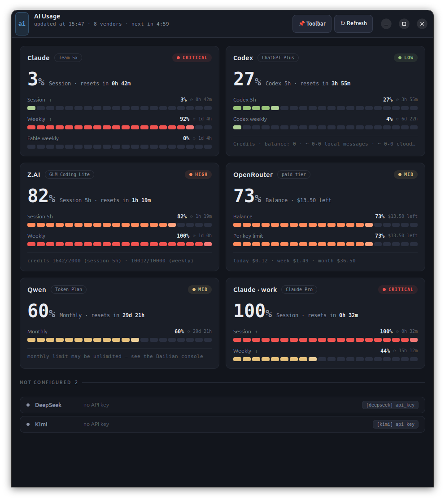

# AI Usage Popup

A small GTK popup for Linux that shows, in one window, how much of each AI plan you have used: **Claude**, **Codex (OpenAI)**, **Z.AI**, **OpenRouter**, **DeepSeek**, **Kimi** and **Qwen**. Each card shows the usage of every window (session, weekly…) and how long until it resets.



The same usage can live as a **toolbar**: a thin, undecorated, always-on-top bar pinned to the
bottom edge of the screen at full width, one compact block per vendor, for leaving it visible
like a taskbar while you work.


It reads most vendors through [ai-usagebar](https://github.com/akitaonrails/ai-usagebar), the Waybar widget by Fabio Akita, so it works with the same configuration. Two exceptions read their sources directly: Z.AI calls its quota API (ai-usagebar does not map the credit limits that Lite plans report), and Qwen shells out to Bailian's `bl usage token-plan`.

## Features

- One card per vendor, with a gauge per usage window and the time left until each reset.
- Multiple Claude accounts: each `[[anthropic.accounts]]` entry in ai-usagebar's config gets its
  own **Claude · <label>** card, next to the default account's card.
- Drag a card onto another position to reorder the grid; the other cards shift along. The order is saved automatically and restored when reopening the popup.
- All vendors are read in parallel; a slow or broken vendor does not hold up the others.
- Vendors without credentials are grouped under **Not configured**, with the setting that is missing.
- A **toolbar** presentation: pin the usage as a thin, undecorated, always-on-top bar on the bottom
  edge of the screen (📌 Toolbar in the header, **i** in the bar to come back). One compact block
  per vendor, each meter line with its own status dot, green to red by that meter's usage; the bar
  reserves its strip, so maximized windows stop above it. The choice is remembered between runs.
- **Automatic refresh every 5 minutes** through the same path as the manual one, with a countdown
  next to the last-update stamp (`updated at HH:MM · N vendors · next in M:SS`); while a cycle is
  in flight the header says `updating…`.
- **↻ Refresh** button, and the time of the last update.
- Single Python file, no dependencies beyond GTK.

## Requirements

- Linux with GTK 3
- Python 3.11 or newer with PyGObject (Debian/Ubuntu: `sudo apt install python3-gi gir1.2-gtk-3.0`)
- [ai-usagebar](https://github.com/akitaonrails/ai-usagebar) installed and configured for the vendors you use

## Install

```bash
git clone https://github.com/dhanyel/ai-usage-popup.git
cd ai-usage-popup
./install.sh
```

This installs `~/.local/bin/ai-usage-popup`, a launcher (**AI Usage Popup** in your applications menu) and its icon. No sudo. To remove it: `./install.sh --uninstall`.

You can also run it straight from the checkout: `./ai-usage-popup`.

## Configuration

Card positions are saved in `~/.config/ai-usage-popup/card-order.json` (or under `$XDG_CONFIG_HOME`
when set); the chosen presentation, cards or toolbar, is remembered in `mode.json` next to it.

Vendor credentials live in ai-usagebar's `~/.config/ai-usagebar/config.toml`; see its README.

For a **second Claude account**, register it in that same file — ai-usagebar's "Multiple accounts"
section has the details:

```toml
[[anthropic.accounts]]
label = "work"
credentials_path = "/home/you/.claude-work/.credentials.json"
```

Each entry becomes its own **Claude · work** card in the popup, refreshed together with the rest
(no restart needed: the list is re-read on every refresh). The field is `credentials_path` — with
`path` ai-usagebar rejects the whole config.toml and every card goes offline, not just that one.
An entry pointing at the default account's own `~/.claude/.credentials.json` is skipped, so the
same numbers are never rendered twice.

For Z.AI, the popup reads the API key from the same file:

```toml
[zai]
api_key = "your-z.ai-key"
```

or, if it is not there, from the `ZAI_API_KEY` environment variable. Prefer the file: a desktop launcher does not see variables exported in `~/.bashrc`.

For **Qwen** (Bailian Token Plan), install the Bailian CLI and log in to the console once:

```bash
npm i -g bailian-cli
bl auth login --console
```

Until that login, the Qwen card sits under **Not configured** with `bl auth login --console` as the
fix.

## Development

```bash
python3 -m unittest -v
```

The tests cover the Z.AI response parsing and error handling, the ai-usagebar output parsing, the
formatting helpers and the toolbar presentation (meter picking, mode persistence, toggling and
layout). The GTK ones need a display: run them under `xvfb-run -a` locally, as CI does on
Ubuntu 24.04.

## License

[MIT](LICENSE) © Dhanyel Nunes
